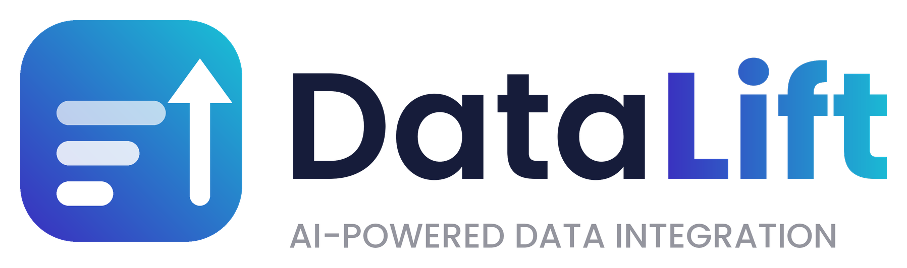

# DataLift — modules

[](https://github.com/youcefaddou/datalift-modules/actions/workflows/ci.yml)

<p align="center"></p>

Plateforme d'intégration de données assistée par IA. On connecte des logiciels métier via leurs API, on réunit leurs données dans un modèle commun, et on décrit en langage naturel le flux voulu. L'IA propose, un humain valide, DataLift exécute et supervise.

Ce dépôt contient les modules développés par l'équipe Ydays : connecteurs, API simulées, données synthétiques, pipelines, interface.

## M1 en bref

- **Catalogue** : Yooz, IFS, Lucca, Progessi, TeamTailor, Personio (remplace eTemptation), Odoo Notes de frais (remplace Notilus), Sage.
- **Flux exécutés** (tous vers IFS) : factures Yooz, collaborateurs Lucca, feuilles de temps Progessi.

Détails : [docs/CONTEXT.md](docs/CONTEXT.md).

## Démarrage rapide

Prérequis : `git`, `make` (`sudo apt install make`) et [uv](https://docs.astral.sh/uv/) (`curl -LsSf https://astral.sh/uv/install.sh | sh`). uv installe lui-même Python 3.12.

```bash
git clone <url-du-depot>
cd datalift-modules
cp .env.example .env        # puis compléter
make setup                  # installe les dépendances (uv sync)
make test                   # lance les tests
make lint                   # ruff : lint et format
make mocks                  # API simulées : IFS sur :8001, Progessi sur :8002
```

`make format` corrige le formatage. La CI GitHub Actions (`.github/workflows/ci.yml`) lance `make setup`, `make lint` et `make test` sur chaque PR et chaque push sur `main`.

## Structure

```
datalift-modules/
├── AGENTS.md            # contexte pour les assistants IA (à lire en premier)
├── CLAUDE.md            # point d'entrée Claude Code
├── GEMINI.md            # point d'entrée Gemini
├── .cursor/rules/       # règles Cursor
├── contracts/           # modèle commun + interface connecteur (chef de projet)
├── mocks/               # API simulées
│   └── specs/           # documentations officielles des API (OpenAPI, JSON, Postman)
├── synthetic_data/      # générateurs de données synthétiques
├── connectors/          # un dossier par logiciel
├── pipelines/           # bronze, silver, gold
├── ui/                  # interface de validation
├── tests/
├── infra/               # Docker, Terraform, CI
└── docs/                # documentation du projet
```

## Documentation

- [Contexte produit](docs/CONTEXT.md)
- [Architecture](docs/ARCHITECTURE.md)
- [Feuille de route](docs/ROADMAP.md)
- [Conventions](docs/CONVENTIONS.md)
- [Politique des données](docs/DATA_POLICY.md)
- [Glossaire](docs/GLOSSARY.md)
- [Intégration d'un nouveau membre](docs/ONBOARDING.md)
- [Décisions d'architecture](docs/decisions/)

## Contribuer

Voir [CONTRIBUTING.md](CONTRIBUTING.md).
